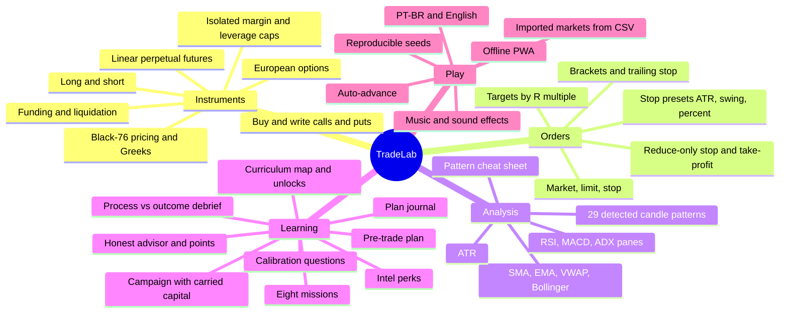
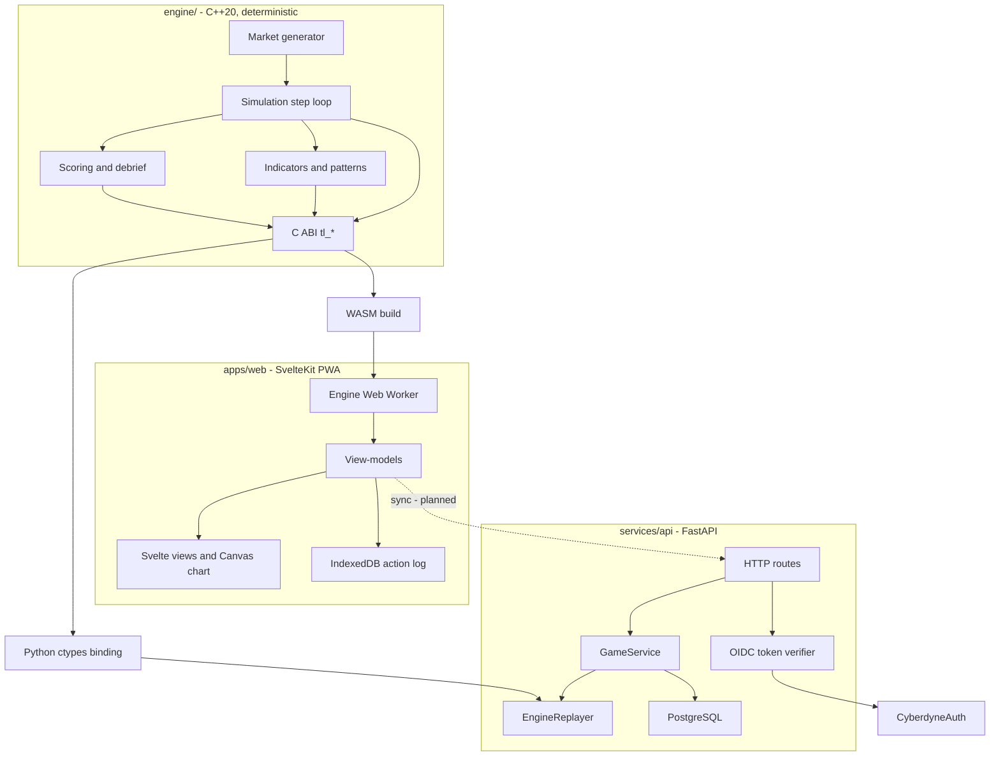
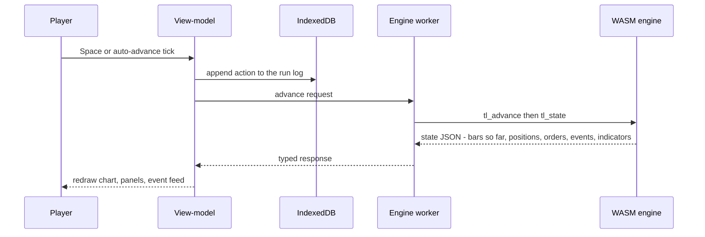
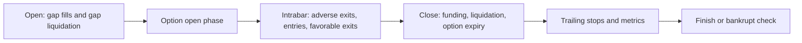
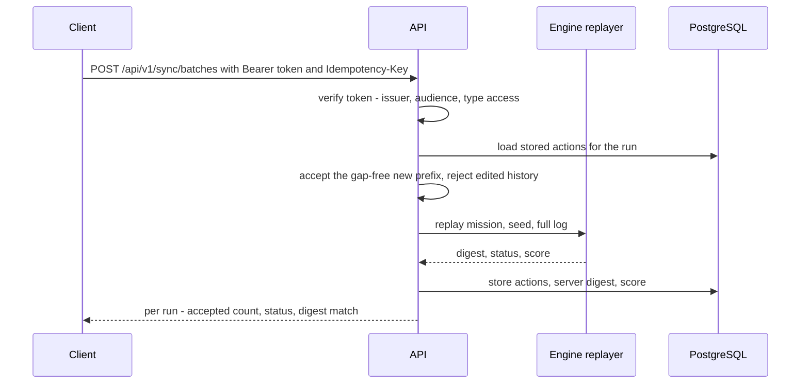
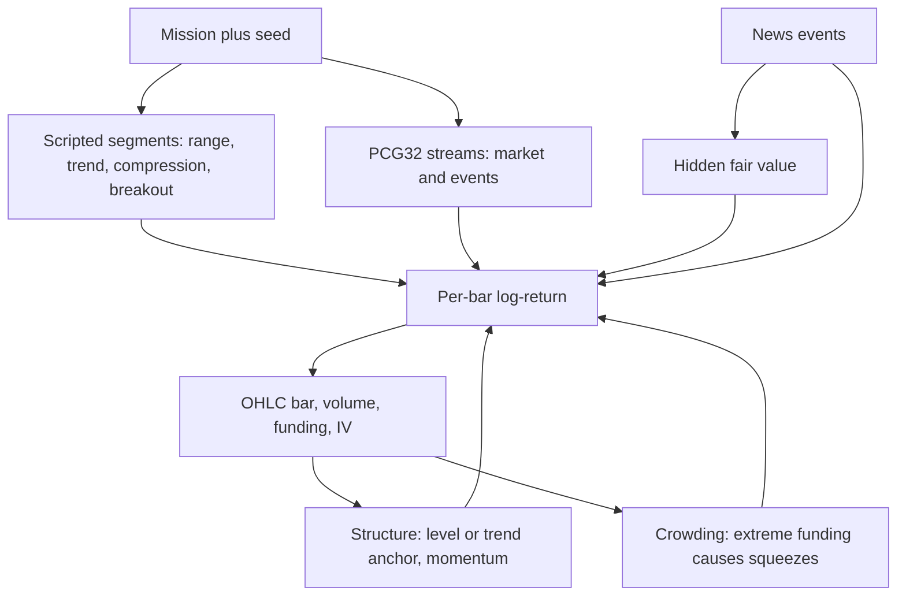
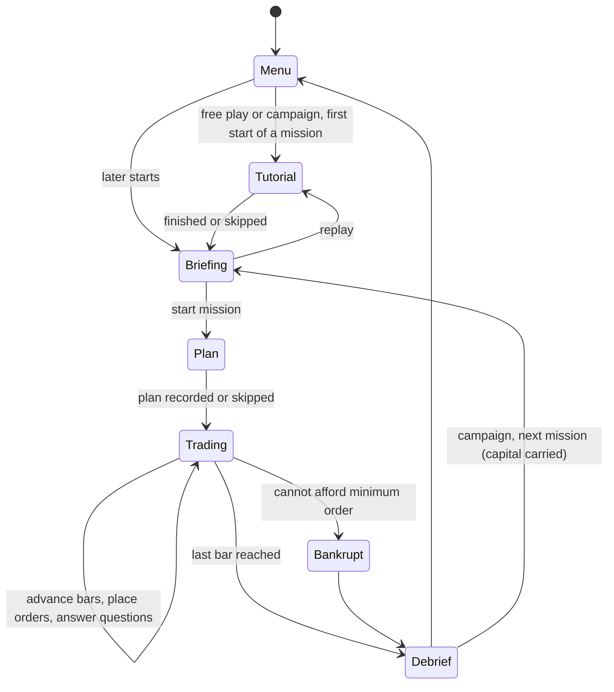

# Cyberdyne TradeLab

Educational trading game: learn **perpetual futures** (long/short, leverage, funding, liquidation) and **European options** (buy and write calls/puts) in a retro terminal, on synthetic markets that follow readable rules but never guarantee an outcome. Virtual money only — no real orders, ever.

| Where | What |
|---|---|
| `docs/product-spec.md` | Product vision and roadmap |
| `openspec/changes/` | Normative requirements (OpenSpec), one change per area — see [Specs](#specs-openspec) |
| `engine/` | Deterministic C++20 simulation core — [`engine/README.md`](engine/README.md) |
| `bindings/python/` | Python (ctypes) binding over the engine C ABI, used by the API |
| `apps/web/` | SvelteKit web client (PWA, works offline) — [`apps/web/README.md`](apps/web/README.md) |
| `services/api/` | FastAPI backend: sync, server-side replay, progress — [`services/api/README.md`](services/api/README.md) |
| `tools/` | Lint helpers (banned-API check for the engine) |

## Play locally

Requires Node 22+, CMake, Ninja and Emscripten (`brew install emscripten`).

```bash
cd apps/web
npm install
npm run engine:build   # compiles engine/ to WebAssembly
npm run dev            # http://localhost:5173
```

Add `?seed=123` to the URL to replay the same synthetic market.

| Key | Action |
|---|---|
| `Space` | Advance 1 bar (pauses auto-advance while it runs) |
| `Shift+Space` | Advance 5 bars |
| `A` | Auto-advance on/off (speeds 1×/2×/4×/10× in the top bar) |
| `M` | Sound on/off (music and effects; volumes in the menu settings) |
| `B` / `S` | Ticket side: buy / sell |
| `X` | Close position |
| `P` | Candle and chart pattern cheat sheet |
| `?` | Shortcut help |
| `Esc` | Close dialogs, cancel "mark on chart" or a line drag |
| `Enter` | Submit the order (only when the submit button has focus — advancing never shares a key with submitting) |

Shortcuts are ignored while typing in a field, while a plan or calibration dialog is open, and while marking a level on the chart.

## Features



| Area | Details |
|---|---|
| Missions | 8 synthetic missions (table below). Each has a first-start tutorial, a briefing, objectives, a leverage cap and a "what was really going on" reveal in the debrief. Missions played to the end are marked Completed in the menu. Free play starts any of them with its own rules. |
| Campaign | The missions in curriculum order (m06, m01, m03, m02, m07, m04, m05, m08) with **capital carried** from one mission to the next; bankruptcy ends the campaign run and a new one starts from 10,000. Leverage above 2× stays locked in campaign missions until Futures II is passed (see [Campaign and curriculum](#campaign-and-curriculum)). |
| Curriculum and progress | A map of the 13 curriculum stages (passed, open, locked, coming soon), what each one assesses and unlocks, missions completed and campaign runs played. Passed stages are never lost. |
| Journal | Every plan you wrote (thesis, invalidation, target, confidence, planned risk), run by run, filterable by mission. It stays on the device and is never scored. |
| Perpetual futures | Isolated margin, leverage up to the mission cap, funding every N bars, mark-to-market, liquidation, bankruptcy (game over when you can't afford the minimum order). |
| Options | Cash-settled European calls/puts priced with Black-76 on the perpetual, with an IV model, Greeks, option chain, writing with margin and margin calls. |
| Orders | Market / limit / stop entries, reduce-only stop-loss and take-profit (brackets, OCO), trailing stop, costs (fees, spread, slippage, bar-volume capacity). The ticket warns when a new leverage would re-margin the open position (liquidation before → after), both tickets refuse an order whose margin (or an option buy whose premium) exceeds the available balance, an order against the open position says whether it reduces, closes or reverses it, and a market sell of an option with no bid (0,00) is refused. |
| Stop/target tools | Stop presets (1×/2× ATR, swing low/high, 1%/2%), targets at 1R/2R/3R, "mark on chart" picking, stop/target lines draggable on the chart (a working STOP/TP is moved in place by the engine's `MoveOrder`, policy v13, so a bracket leg keeps its OCO link), live reward/risk and an unprotected-position warning. |
| Indicators | SMA20, EMA50, VWAP (24-bar sessions) and Bollinger(20,2) overlays; RSI14, MACD(12,26,9) and ADX14/±DI panes; ATR14. All computed in the engine from closed bars only. |
| Candle patterns | 29 single- and multi-candle patterns detected in context (e.g. hammer vs hanging man), marked on the chart and linked to a cheat sheet that also covers 9 chart patterns. Each candle drawing animates the textbook outcome (confirmation candle, then follow-through) and the failure (close through the stop). |
| Coaching | Pre-trade plan (side, invalidation, target, risk), calibration questions ("what's the probability that…?"), debrief that scores **process, not P&L**. |
| Advisor | An honest coach in the engine: for 1 point it reads what is visible now (regime, RSI, Bollinger, MACD, ADX, the latest candle pattern, released news, funding) and answers long, short or wait with a confidence of 50–65%, a 2×ATR stop, a size risking 1% and its reasons. "Put stop and size in the ticket" fills the ticket without sending anything, raising the leverage when the size needs more margin than 1x allows. The debrief lists every read and whether it was right 5 bars later. Points are earned by disciplined trades (see [Advisor points](#advisor-points)). |
| Intel perks | Legal information products unlocked by finishing distinct missions: an economic calendar (bar of the next rate decision, nothing about its content) and a fast news wire (headlines 1 or 2 bars before their public release, marked early). Toggles on the free-play briefing, on by default; the bars are identical with or without them, and the run is labeled "with intel" (see [Intel perks](#intel-perks)). |
| Auto-advance | Plays bars on a timer, waits for any open dialog, pauses on fills, liquidation, margin calls, option expiry and news (also when a fast wire delivers a headline early). |
| Sound | Music follows the moment: menu theme, in-game theme, and a tense theme when you are near liquidation or under a margin call. Closing a trade plays a win or loss sting. `M` mutes; music and effects volumes are separate. Audio (`apps/web/static/audio`, MP3 96 kbps) is cached on first play, not at install. |
| Imported markets | A CSV import wizard turns your own OHLCV file (optional funding) into a practice mission. The engine validates it (order, duplicates, OHLC consistency, timestamp unit, interval) and reports gaps without filling them, masks prices to a base of 100, and stores the result as a private pack signed by the device. The asset, pair and period are revealed only in the debrief. Signed `.tlpack` files can be exported and loaded; packs from unknown keys are refused. |
| Offline | Installable PWA; every action is committed to IndexedDB before it reaches the engine, so a reload resumes exactly where you were. |

### Missions

All synthetic, generated from the run seed, starting capital 10,000 (virtual).

| ID | Title | Instrument | Lesson | What the debrief reveals |
|---|---|---|---|---|
| `m01-false-breakout` | Range | Perpetual, up to 5× | Long and short, orders and stops | A false breakout: priced-in rumor, then a credible denial |
| `m02-funding-squeeze` | Momentum | Perpetual, up to 10×, funding every 4 bars | Funding and the cost of carry | Crowded longs, pullbacks to the EMA, then a squeeze |
| `m03-volatility-shock` | Quiet market | Perpetual, up to 20× | Margin, leverage and liquidation price | Volatility compression, then a gap shock |
| `m04-options-buyer` | Calls and puts | Options (buy) + perpetual up to 3× | Payoff, premium, IV and Greeks | IV run-up and crush around a rate decision; breakout direction not guaranteed |
| `m05-options-writer` | Selling premium | Options (buy and write) + perpetual up to 3× | Writing options, margin and margin calls | Rich premium in a range, then a jump before the first expiry forces a margin call on oversized writers |
| `m06-thin-book` | Thin book | Perpetual, **long only**, up to 2×; half-spread 0.10%, slippage 0.20%, 4% of bar volume per bar | Structure and orders: zones, limit vs market, spread, slippage and capacity | A range in a thin book; a market maker pulls quotes (no surprise: depth changes, value does not; spread and slippage stay the same), then liquidity returns and the market leaves the range in a drawn direction, more often up |
| `m07-trend-trailing` | Size and exit | Perpetual, up to 5× | Risk sizing: size from the stop, trailing stops, R multiples | A credible adoption headline tilts a trend whose direction is drawn per seed (up in about 6 of 10); pullbacks take out tight trails, a 3×ATR trail stays in |
| `m08-regime-switch` | Signals | Perpetual, up to 5× | Patterns and indicators: mean reversion vs trend following, ADX and band width as late filters | A Markov chain of range, trend and high-volatility regimes drawn per seed; the debrief draws the regime band and how each read did in each regime |

The debrief of every built-in mission also shows the **seeded reveal** (engine `tl_mission_reveal`, asked only after the run ended): a band of the regimes the run went through, a signals-by-regime table (RSI fade, Bollinger fade, MACD follow, SMA20 follow: hits out of samples inside each regime) and, for each trade, the regime it was entered in.

## Architecture

One deterministic engine runs everywhere. Clients play offline; the server never trusts a client's balance or score — it replays the action log through the same engine and compares digests.



| Layer | Stack | Notes |
|---|---|---|
| Engine | C++20, CMake presets | Fixed-point int64 (`Price`, `Qty`, `Money` at 1e-8, `Rate` at 1e-10), own `det::` math kernels, PCG32 RNG, no I/O/clock/threads. Bit-identical on native x86-64/arm64, WASM and Python, locked by golden digests. |
| C ABI | `engine/include/tradelab/c_api.h` | `tl_run_create`, `tl_place_order`, `tl_advance`, `tl_state` (JSON), `tl_checkpoint`, `tl_debrief`, … — the only surface bindings use. |
| Web | SvelteKit + Svelte 5 runes, TypeScript strict, MVVM | Engine in a Web Worker; Canvas2D chart; i18n PT-BR first, English second; Vitest + Playwright. |
| API | Python 3.12, FastAPI, SQLAlchemy, hexagonal (ports/adapters) | Idempotent batch sync, replay through the engine, progress, export and erase. Access tokens from CyberdyneAuth verified via discovery + JWKS. |
| CI | GitHub Actions | `engine` (Linux/macOS native, WASM, lint, clang-tidy, OpenSpec validate), `web` (check, unit, e2e), `api` (pytest on SQLite and PostgreSQL). |

### How a bar is played

Everything the player does is a command in a log. The engine is the only thing that changes state, so replaying the log with the same mission and seed reproduces the run exactly.



Inside one step (`engine/src/advance.cpp`) the engine processes the next bar in a fixed order:



Intrabar order is **conservative**: when a bar touches both your stop and your target, the engine assumes the worse one happened first and flags the fill as ambiguous. The player only ever sees closed bars — indicators and patterns never look ahead (property-tested by mutating the future and comparing the past).

### Sync and server replay (backend)



The web client does not call the API yet (login via a BFF is the next milestone); the API itself is implemented and tested.

## How the market data is created

Markets are synthetic and generated by the engine from `(mission, seed)`. The goal is a market that **rewards good analysis on average without ever guaranteeing it**: technical structure, fundamental news and randomness all move the price, and calibration tests measure how much edge each one gives.



Each bar's log-return is the sum of:

| Component | Analysis it rewards | How it works |
|---|---|---|
| Segment drift and volatility | Reading the regime | Missions script segments (range, trend, quiet compression, breakout) with their own drift and vol; volatility clusters (GARCH-like) and has jumps. The first segment's length is drawn per seed, so later segments and news land on different bars each run. |
| Regime chain (m08) | Telling regimes apart | Instead of a script, a Markov chain draws the sequence of regimes per seed: each visit lasts 25–50 bars and the next regime comes from a transition table, with no headline announcing a switch. Each segment carries a label (range, trend, high volatility, thin book...) that only the debrief's reveal uses. |
| Hidden fair value | Fundamental | A latent value moved by segment drift, by most of each information jump, and by news surprises. Price is pulled toward it slowly (`fair_pull`), so news has lasting effect. |
| News | Fundamental | Scheduled releases (headline, expected vs actual, credibility). A surprise moves fair value on the next bar, and 80% of that move is priced at once as an opening gap. A short, uncertain transient reaction follows. News before a breakout tilts its direction. |
| Level anchor | Technical (ranges) | In range segments price reverts to the range center and meets soft walls at the edges — fading extremes works more often than not. |
| Trend anchor and momentum | Technical (trends) | Trend segments revert to their 20-bar EMA (pullbacks get bought) and carry momentum. |
| Random-direction segments | Uncertainty | Breakouts pick a direction at random, tilted by the gap to fair value: the fundamental side wins more often, not always. |
| Crowding squeezes | Positioning | When funding is extreme, a sharp move against the crowded side becomes possible (a few percent per bar). Until it comes, the crowd is usually right. Squeezes don't move fair value. |
| Funding, volume, implied vol | Derived | Funding follows recent drift plus the segment's crowding, and is published from the last closed bar only. Volume grows with the size of the move. Implied vol prices smoothed recent volatility plus a premium. |
| Noise | Randomness | Normal variates from a dedicated PRNG stream. |

Nothing in the generator reads the future. Indicators, patterns, funding and implied vol are all computed from closed bars, and an order sent at a bar's close fills from the next bar's open.

### What can the player predict?

There are two ways to measure it.

- **Calibration tests** (`engine/tests/test_generator.cpp`, 200 seeds per check) use clean, single-regime markets to check that each structural term gives a small edge and never a certain one. For example, fading RSI extremes inside a range works 58–72% of the time, buying a trend pullback 57–72%, and a structure-free random walk gives RSI no edge (35–65%).
- **The missions themselves** mix regimes, so the player first has to tell which one they are in. `tools/market_study.py` plays every mission on 100 seeds without trading and measures each signal from the next bar's open, the earliest price a player can actually get. The tables below are its output. `engine/tests/test_mission_realism.cpp` asserts the bands (60 seeds), so CI fails if a generator change makes the missions predictable again.
- **Reference players** (`engine/tests/test_mission_learnability.cpp`, 60 seeds) trade scripted rules through the engine, with its fills, costs, stops and trails, and assert what a disciplined player can learn in each mission and that nothing is guaranteed (see [Learnable, never guaranteed](#learnable-never-guaranteed)).

**Technical signals** (8 missions × 100 seeds, outcome 5 bars later; the test requires 42–58% for RSI, Bollinger, MACD and SMA20):

| Signal | Samples | Goes the predicted way | Average move in its favor |
|---|---|---|---|
| MACD histogram: follow its sign | 73,806 | 51.9% | +0.11% |
| Last bar's color, next bar only | 73,152 | 51.7% | +0.03% |
| ADX > 25: follow the stronger DI | 37,181 | 51.3% | +0.05% |
| Close vs SMA20: follow | 73,798 | 50.9% | +0.05% |
| MACD cross: follow | 5,445 | 50.7% | +0.14% |
| Candle pattern: follow its bias | 11,637 | 49.9% | -0.00% |
| Bollinger: fade a close outside the bands | 9,847 | 47.3% | -0.21% |
| RSI < 30 buy, > 70 sell | 12,547 | 44.2% | -0.28% |
| Extreme funding (> 0.06%): fade the crowd | 5,584 | 37.7% | -0.40% |

What this means:

- **No indicator is a signal on its own.** Every one of them is within a few points of a coin flip, which is also what studies of real markets find.
- **Context is the skill.** Fading RSI works inside a range and fails inside a trend. The calibration tests show the edge is there once the regime is right, and the signals-by-regime table below shows it inside the missions. Pooled over missions with long trends (m06–m08), fading extremes loses more often than it wins.
- **Extreme funding is a warning, not a timing signal.** The crowd paying high funding is usually on the right side of the trend, until the squeeze. Fading it bar by bar loses more often than it wins.

**Candle patterns.** The engine detects 29 candle patterns on closed bars. `engine/tests/test_candle_patterns.cpp` measures them over 480 generated markets (8 missions × 60 seeds), counting a pattern as working when the close 5 bars later moved its way:

| Signal | Samples | Next 5 bars go the predicted way | Test band |
|---|---|---|---|
| Any pattern on its own | 9,964 | 50.5% | 45–60% |
| Pattern plus an extreme RSI (< 30 bullish, > 70 bearish) | 1,023 | 51.2% | 45–62% |
| Kickers (gaps, usually caused by news) | 48 | 62.5% | 40–70% |

Patterns alone are close to a coin flip, as in real markets, and the in-game cheat sheet says so plainly. Kickers are news gaps: the information is already in the gap, and on a few dozen samples what follows is no reliable edge.

**The advisor.** The advisor (`engine/src/advisor.cpp`) combines the same reads the way a textbook would: in a trend (ADX > 25) it follows the stronger DI and the MACD histogram; in a range (ADX < 20) it fades an extreme RSI or a close outside the Bollinger bands; a candle pattern from the last 2 bars votes its way, twice as strongly when it reverses the move that led into it in the regime's favor. A credible surprise released in the last 3 bars is "already priced" and pulls the read toward wait, as does ATR at a 30-bar low. Crowded funding is shown as a warning but does not vote, since the crowd is usually right until the squeeze. Long or short needs at least two net votes, and the confidence is 50% + 4 points per net vote, capped at 65%. It only ever reads the visible market (property-tested by changing every later bar, funding and headline). `tools/market_study.py` asks it every 5 bars and `test_mission_realism.cpp` holds it to 45–65% right in every mission, wait at least 20% of the time, and a mean stated confidence within 8 points of its hit rate:

| Advisor, every 5 bars (100 seeds) | Long/short reads | Right | Mean stated confidence | Wait |
|---|---|---|---|---|
| m01-false-breakout | 438 | 48.6% | 58.2% | 71% |
| m02-funding-squeeze | 718 | 52.2% | 58.3% | 66% |
| m03-volatility-shock | 474 | 47.7% | 58.5% | 72% |
| m04-options-buyer | 432 | 60.6% | 58.3% | 71% |
| m05-options-writer | 485 | 48.0% | 58.3% | 71% |
| m06-thin-book | 573 | 52.4% | 58.3% | 72% |
| m07-trend-trailing | 628 | 60.2% | 58.3% | 67% |
| m08-regime-switch | 658 | 51.4% | 58.3% | 71% |
| all missions | 4,406 | 52.8% | 58.3% | 70% |

The advisor is no oracle. It says "wait" most of the time and, when it commits, it is right about as often as it claims. Following trends fails in m01's false breakout and after m03's shock, and works in m04's breakout. Like every other tool, it is worth something only with a stop and a sensible size.

**News.** Credible news is priced on arrival: 80% of a surprise's effect on fair value opens the next bar as a gap. What is left is a small, uncertain drift. The table shows the gap, then what following the surprise's direction from that open earns over 10 bars. The test requires every row to be under 72%, and a credible shock to gap by more than 3%.

| News (mission, headline, surprise) | Gap at the next open | Goes the predicted way | Average move |
|---|---|---|---|
| m01 rumor, surprise 0 | 0.00% | 54% | +0.24% |
| m01 credible denial, surprise -2 | -4.12% | 57% | +0.36% |
| m02 inflow, surprise 0 | -0.01% | 71% | +1.12% |
| m02 rate decision, surprise -1 | -2.41% | 62% | +1.24% |
| m03 exchange incident, surprise -2 | -7.83% | 41% | -1.06% |
| m04 rate decision, surprise +1 | +2.50% | 65% | +3.29% |
| m05 network outage, surprise -2 | -7.99% | 62% | +2.11% |
| m06 market maker pulls quotes, surprise 0 | +0.03% | 44% | -0.32% |
| m06 liquidity inflow, surprise +1 (credibility 60) | +1.43% | 49% | +0.02% |
| m07 adoption, surprise +1 (credibility 75) | +1.21% | 65% | +1.20% |

So the edge belongs to whoever was positioned, with a stop, before the news. A trade placed after the headline is late, as in a real market.

**Fast wire (intel perk).** The same headlines followed from the first open after a fast wire shows them (right, then average move in their favor, 10 bars after release; same 100 seeds, since perks never change the bars):

| News, followed for 10 bars after release | Public (next open) | Fast wire I (1 bar early) | Fast wire II (2 bars early) |
|---|---|---|---|
| m01 rumor, surprise 0 | 54%, +0.24% | 58%, +0.93% | 64%, +1.70% |
| m01 credible denial, surprise -2 | 57%, +0.36% | 88%, +4.69% | 92%, +5.16% |
| m02 inflow, surprise 0 | 71%, +1.12% | 71%, +1.16% | 70%, +1.30% |
| m02 rate decision, surprise -1 | 62%, +1.24% | 79%, +3.88% | 79%, +4.33% |
| m03 exchange incident, surprise -2 | 41%, -1.06% | 70%, +6.75% | 70%, +6.79% |
| m04 rate decision, surprise +1 | 65%, +3.29% | 73%, +5.80% | 73%, +5.80% |
| m05 network outage, surprise -2 | 62%, +2.11% | 88%, +10.12% | 88%, +10.12% |
| m06 market maker pulls quotes, surprise 0 | 44%, -0.32% | 44%, -0.43% | 43%, -0.42% |
| m06 liquidity inflow, surprise +1 | 49%, +0.02% | 61%, +1.35% | 62%, +1.38% |
| m07 adoption, surprise +1 | 65%, +1.20% | 76%, +2.40% | 78%, +2.45% |

A fast wire turns a late trade into one placed before the gap, so a credible shock goes from about a coin flip to 70–92% right and +4 to +10% per trade. Most of the edge comes from the first bar (Fast wire I); the second adds little, because the gap is what the early headline buys. That is why perks are opt-in, labeled "with intel" in the debrief and the run record, and kept out of campaign runs. The no-surprise items (m01 rumor, m02 inflow) gain little: there is no gap to get ahead of. m02's inflow row is high because it lands during the uptrend: the trend does the work, not the headline.

**Timing.** Each mission's calm opening phase lasts a different number of bars per seed: m01 70–82, m02 56–70, m03 70–90, m04 64–76, m05 66–82, m06 74–88 and m07 66–80. Every later segment and headline moves with it, so the story is the same but the bar it turns on is not. The option missions keep their shocks before the first expiry. m08 has no script at all: its regimes and their lengths are drawn per seed, and its first switch after the warm-up lands on no 3 bars in more than 13 of 60 seeds.

**Signals by revealed regime** (the debrief's table, pooled over 100 seeds; hits and samples). The same reads flip from useful to harmful when the regime changes, which is what m08 teaches on the player's own run:

| Mission, regime | RSI fade | Bollinger fade | MACD follow | SMA20 follow |
|---|---|---|---|---|
| m01, range | 74% (192) | 63% (431) | 48% (5,089) | 44% (5,089) |
| m04, trend | 21% (1,194) | 25% (693) | 72% (1,996) | 74% (1,996) |
| m06, thin book (low liquidity) | 71% (208) | 57% (507) | 48% (3,385) | 45% (3,385) |
| m06, trend | 27% (724) | 26% (454) | 70% (2,199) | 70% (2,199) |
| m07, range | 61% (213) | 59% (266) | 46% (3,689) | 44% (3,689) |
| m07, trend | 27% (1,776) | 30% (826) | 62% (4,389) | 70% (4,389) |
| m08, range | 60% (270) | 59% (363) | 47% (3,919) | 45% (3,919) |
| m08, trend | 29% (1,132) | 29% (521) | 64% (3,789) | 69% (3,789) |
| m08, high volatility | 67% (280) | 65% (482) | 46% (3,763) | 44% (3,762) |

`tools/market_study.py` prints every mission and regime.

### Learnable, never guaranteed

`engine/tests/test_mission_learnability.cpp` plays reference players through the engine over 60 seeds (design D8.3). Every reference strategy loses in at least 15% of seeds, and buy-and-hold (1× long from the first open) is never the obvious answer:

| Mission | Buy-and-hold positive (100 seeds) | What a disciplined player can learn (60 seeds, as measured) |
|---|---|---|
| m01 | 35% | |
| m02 | 43% | |
| m03 | 0% | |
| m04 | 70% | |
| m05 | 17% | |
| m06 | 56% | A 2×-equity market order is cut by capacity in 91% of thin-book bars. A limit at the 20-bar low fills in full within 5 bars in 99% of the times price trades through it. Fading the lower band at market loses on average (−8.6 per trade, costs 34.1); the same fades with a limit entry and a take-profit cost 7.8 per trade. A stop-market in the thin phase fills on average 0.31% beyond its trigger. |
| m07 | 61% | The trend goes up in 63% of seeds. A breakout follower after the headline (2×ATR stop, 3×ATR trail, 1% risk) wins in 63% and has a return/drawdown of 1.29 against buy-and-hold's 0.43. A 1×ATR trail exits within 5 bars of entry in 67% and keeps 28% of what the 3×ATR trail keeps. A fixed 2R target wins about as often (63%) but earns half as much when the trend goes the trade's way. |
| m08 | 42% | Inside range spans RSI fades win 56%, inside trends 31%; EMA(20) pullbacks win 67% inside trends and 48% inside ranges. An ADX filter (fade below 20, follow above 25 with the DI lines) beats fading everywhere by 8 points but not the pullback rule (50% both): ADX(14) turns about as late as a regime lasts. |

The test bands are 45–75% buy-and-hold for m06 and 35–65% for m08, and below 75% everywhere.

### How close is this to a real market?

| Mission | Excess kurtosis | Autocorrelation of returns | Autocorrelation of absolute returns | Biggest drop: share of seeds on its 3 most common bars |
|---|---|---|---|---|
| m01-false-breakout | 7.2 | +0.05 | +0.17 | 33% |
| m02-funding-squeeze | 3.7 | +0.07 | +0.23 | 22% |
| m03-volatility-shock | 25.0 | +0.06 | +0.34 | 23% |
| m04-options-buyer | 6.6 | +0.18 | +0.33 | 18% |
| m05-options-writer | 29.4 | +0.01 | +0.31 | 24% |
| m06-thin-book | 1.7 | +0.06 | +0.22 | 13% |
| m07-trend-trailing | 2.2 | +0.05 | +0.23 | 22% |
| m08-regime-switch | 1.3 | +0.02 | +0.21 | 11% |

- **Fat tails.** Excess kurtosis is above 0 everywhere. Real hourly crypto data usually sits around 5–20, and the shock missions are deliberately extreme; the phase-2 missions without shocks (m06–m08) are milder (1.3–2.2).
- **Volatility clustering.** Absolute returns are autocorrelated at 0.17–0.34, similar to real markets: calm follows calm and storms follow storms.
- **Little bar-to-bar trend.** Return autocorrelation is about 0, as in real markets, except in m04, whose scripted breakout carries momentum (+0.18).

**What changed (generator, policy v10):**

| Measure | Before | Now |
|---|---|---|
| Following a credible shock headline from the next open, 10 bars | 86–98% right, +9 to +15% | 41–62% right, -1 to +2% |
| Gap at the open after a credible shock headline | 0.2–2.8% | 4–8% |
| m03 and m05 biggest drop on the same 3 bars | 96–99% of seeds | 23–24% of seeds |
| Return autocorrelation (m01, m03, m05) | +0.17 to +0.27 | +0.01 to +0.06 |

Outcomes are still scripted so each mission teaches its lesson. m01's breakout is back in the range 25 bars after it started in about 70% of seeds, and the denial gaps it down every time. m03 liquidates a 10× long in about 90% of seeds, and m05 margin-calls a writer of 300 puts in about 40%. Randomizing outcomes, such as a breakout that is sometimes real, is planned for a later difficulty mode.

Historical packs from Market4Me are specified but not built yet. The pack format they will use (signed manifest, zstd data, validation in the engine) is built, and players can already import their own CSV as a masked practice market (`engine/README.md`, "Scenario packs and CSV import").

## How the game works



From the menu: **Campaign** (missions in curriculum order, capital carried), **free play** (any mission, its own rules), practice on imported markets, the **curriculum map** and the **journal**.

1. **Tutorial** — the first time you start a mission on a device, 3–5 short illustrated cards explain its concept, what to watch and which controls to use (arrows or Enter to page, Esc to skip). They never hint at what the market will do. Replay them from the briefing.
2. **Briefing** — the mission's story, objectives, instrument and leverage cap. A warm-up history is already on the chart.
3. **Plan** — before trading, write the hypothesis: side, invalidation (stop), target and risk. You can also explicitly plan to stay out — not trading is a valid decision.
4. **Trading** — advance bar by bar (or with auto-advance). Place orders, move stops, read news, watch funding, ask the advisor for a read (1 point). The game occasionally asks calibration questions ("probability price is higher in 10 bars?").
5. **Debrief** — the engine scores the run on process:

| Dimension | Weight | What it measures |
|---|---|---|
| Risk | 35 | Penalties for a liquidation or an option margin call, entries without a stop, trades entered with planned risk above 2% of capital, stops beyond the liquidation price, drawdown above 20% |
| Plan | 25 | Share of entries covered by a plan, and plans that name an invalidation level |
| Understanding | 25 | Reserved for lesson questions; not scored yet |
| Calibration | 15 | 100 × (1 − 2 × Brier score) of your probability answers, floored at 0 (needs 3+ resolved answers). Always answering 50% scores 50: no information is neutral, not a bonus |

The total is the weighted average of the dimensions that apply to the run (no trades → no plan score). Net P&L is shown but is **not** the score: a disciplined losing trade can score well, a lucky reckless one scores badly. The debrief lists every trade — perpetual and options, with option trades settled at expiry — (R multiple, exit reason, plan respected; each trade's net includes its share of fees and the funding paid while it was open, and a trade still open at the end includes its unrealized P&L, so the trades add up to the result), findings, and a reveal of what the generator was doing.

The exit reason comes from the order that closed the trade (scoring v10): stop, trailing stop, target (a take-profit or limit), manual (a market order), liquidation, expiry or margin call. A stop that exits in profit is still a stop.

Next to the score, the debrief shows outcome facts that are **not** score inputs (all computed by the engine, scoring v10):

- Net P&L split into realized trading P&L, fees, funding, option P&L, and a separate **spread and slippage** line: what taker fills paid against their reference price (the open, or the stop's trigger) and option fills against the quote's mid. It is already inside the fill prices, not an extra charge. After a margin-call bankruptcy, a **written-off** line shows the option loss beyond the balance that the simulated fund covered (the wallet stops at zero), so the lines still add up to the result. A position still open at the end has its own **open at the end** line (its unrealized P&L, options included), so the lines add up to the net result.
- Max drawdown, peak exposure, **turnover** (traded notional) and the **closest the mark came to liquidation**.
- For options, the **P&L by Greek** (delta, gamma, theta, vega and a residual), labeled approximate: bar by bar by full revaluation, so a gap or a crash lands in delta and gamma with its real sign (price moves: delta = start delta × move, gamma = the rest; time: vega = average vega × IV change, theta = the rest); the residual is the spread paid at the fills, so the five lines add up to the option P&L before fees.
- For a perpetual trade whose stop (stop order, else the plan's invalidation) sat at or beyond its liquidation price (at the highest leverage the position carried, including a re-leverage while it was open): the **highest leverage that would have kept the stop in front** of liquidation, also named in the liquidation and stop-beyond-liquidation findings.
- When time decay (theta) on bought options, or implied volatility (vega) explains at least half of an option loss, a finding says so and the next lesson is Options II (IV and Greeks). The IV finding follows the side that lost: a falling IV on bought options, or a rising IV on written ones. A written option never gets good-process credit, and a finding says why.
- The flat and buy-and-hold comparisons and the market span run to the run's last bar: after a game over they stop at the game-over bar.
- For built-in missions, the **seeded reveal**: the regimes the run went through (a band under the chart), a **signals-by-regime** table (RSI fade, Bollinger fade, MACD follow and SMA20 follow: hits out of samples inside each regime, read at a close and judged 5 bars after the next open) and the regime each trade was entered in, with the drawn direction of a trend ("Trend up"). The client asks the engine for it (`tl_mission_reveal`) only once the run has ended.

### Campaign and curriculum

A campaign run plays the missions in curriculum order: m06 (Structure and Orders), m01 (Futures I), m03 (Futures II), m02 (Futures III), m07 (Risk sizing), m04 (Options I and II), m05 (Options III), m08 (Patterns and Indicators). m06 opens the campaign, so its tutorial carries the introduction (reading the chart; plan, advisor and points); m01 keeps its own cards for free play. The first starts with 10,000; each later one starts with the final equity of the one before, passed to the engine as a start option (`startingBalance`, policy v12), so the engine stays the only source of balances and the server can replay it. Going bankrupt ends the campaign run (game over, then the debrief, which offers a new campaign run from 10,000). A liquidation that leaves capital does not: the campaign goes on with what is left, as long as it is at least 100 (1% of 10,000). Less than that ends the campaign run like a bankruptcy and passes no stage, since the next mission may cap leverage lower than the one that liquidated (the engine only checks its own mission's cap). Leaving a campaign mission for another run carries the equity it had when it was left, and the campaign stays on that mission; "End campaign" in the menu closes the run by choice (after a confirmation), and its mission in progress ends with it.

Finishing a mission in a campaign run passes its curriculum stages for good: bankruptcy, liquidation or an ended campaign run never remove them. The curriculum (`apps/web/src/lib/game/curriculum.ts`) is data: 13 stages in dependency order, each with its assessment missions and its unlocks. Stages without missions yet (Foundations, which is an Academy lesson, Evaluation and Events) show as coming soon and do not block the next ones. Unlocks are never bought:

| Unlock | Stage that grants it | In a campaign mission before that |
|---|---|---|
| Shorting | Futures I (m01) | Locked |
| Leverage above 2× | Futures II (m03) | The engine caps leverage at 2× (`leverageCap` start option) |
| Buying options | Options I (m04) | Locked |
| Writing options | Options III (m05) | Locked |

A stage's own assessment mission always has its unlocks (it is where they are taught). m06 comes before Futures I and II, so its own rules are long only with a 2× cap; after it, only the leverage cap ever bites (in m01 until Futures II is passed). A unit test checks that no campaign mission meets a lock the engine cannot enforce. Free play keeps every mission's own rules and does not pass stages.

Progress lives in IndexedDB `meta.progress` (version 2): tutorials seen, advisor points, the intel perks already explained, the campaign run, ended campaign runs and the missions assessed. A record from an older build is migrated on load (its tutorials and points are kept).

### Advisor points

Points pay for advisor reads and are earned by process, never bought. The engine reports what a run earned (`advisorPointsEarned` in the debrief, scoring v7), so the server can verify it:

| Earned for | Points |
|---|---|
| Each closed perpetual trade that had a plan (planned risk) and a protective stop working while it was open | +1 |
| ...and that trade made money (net of fees and funding) | +1 |
| Finishing the mission (not bankrupt) | +2 |
| Cap per run | 6 |

The device keeps the balance (IndexedDB `meta.progress`): it starts at 3 and is capped at 10. A run's advice allowance is the balance when it starts; when the run ends the balance becomes balance − reads used + points earned, applied once per run even after a reload. Starting a new run while another can still be resumed settles the one left behind (its reads are charged, it earns nothing), so restarting never refunds reads. Each trade is matched to the plan recorded for its own entry order, so a plan for the next order on the same bar never takes the points of the trade before it. The first mission's tutorial explains this. Each read is an engine command (`RequestAdvice`) in the action log, so a replay or the server's re-simulation reproduces it; with no allowance left it is rejected and changes nothing.

### Intel perks

Perks are modeled on legal products, never on insider information: an economic calendar like the ones brokers publish, and a low-latency news feed like the ones professional desks subscribe to. They unlock by the number of **distinct built-in missions finished** on the device (any mode; imported markets do not count):

| Distinct finished missions | Perk | What the engine adds to the state |
|---|---|---|
| 1 | Economic calendar | `calendar`: the bar of each coming rate decision not visible yet (no expectation, value or tone) |
| 2 | Fast wire I | headlines from 1 bar before their release (`newsLead` 1), flagged `early` until then |
| 4 | Fast wire II | headlines from 2 bars before their release (`newsLead` 2) |

The free-play briefing lists them: unlocked perks are toggles (on by default), locked ones show what is missing ("conclua 2 missões diferentes (1 de 2)"), and the first briefing after an unlock explains the new perk in a card. The choice is part of the run's start options (`newsLead`, `calendar`), so the engine, the run record, a resume and the server's re-simulation all use it. Perks never change a bar, a gap or a fill (`engine/tests/test_intel.cpp` compares bars and event digests with and without them in every mission) and never show a bar after the decision step. A run played with a perk is labeled **with intel** in the debrief and the journal; its score is still computed. Campaign missions and practice on imported markets start without perks, so campaign runs stay comparable.

## Specs (OpenSpec)

Requirements live in `openspec/changes/`, one change per area; `openspec list` shows task progress and `openspec validate --all --strict` runs in CI.

| Change | Capabilities |
|---|---|
| `add-deterministic-engine` | simulation-core, order-execution, perpetual-futures, options, indicators |
| `add-scenarios-and-gameplay` | market-generator, scenario-packs, gameplay-loop, mission-scoring, curriculum |
| `add-web-client` | web-client, terminal-ui |
| `add-cyberdyne-identity-and-backend` | player-identity, game-api, offline-sync |
| `add-native-clients` | desktop-client, ios-client |
| `add-advisor-intel-tutorials` | mission-tutorial, advisor, progression-rewards |

## Status and roadmap

Built: the deterministic engine (perps, options, indicators, patterns, generator v3 with a Markov regime chain, execution policy v15, scoring v10 with the full debrief and the seeded regime reveal), eight missions with first-start tutorials (batch A of phase 2: m06 thin book, m07 size and exit, m08 regime switch), campaign runs with carried capital, the curriculum map and the plan journal, the advisor with points earned by disciplined trades, legal intel perks (economic calendar, fast wire) unlocked by finished missions, the web client (offline PWA, draggable stop/target lines, pattern cheat sheet with outcome animations), the API (sync, replay with each run's start options, progress, export, erase) and scenario packs (signed, zstd, validated in the engine) with private CSV import.

Next:

- Missions m09–m12 toward the phase-2 target (12 missions, ≥4 regimes, 3 event families, options chapters), designed in `add-scenarios-and-gameplay` (design D8, tasks 6.B), and the lessons runner (concept, demonstration, decision, feedback, transfer) for the curriculum stages that have no mission yet.
- Web login through a BFF (needs TradeLab clients registered in CyberdyneAuth) and wiring the client to sync.
- `user_deleted` webhook, Alembic migrations, rate limits; deployment on Coolify.
- Historical packs from Market4Me (needs the packer registered as a CyberdyneAuth client, Market4Me allowlisting and a legal review of vendor-derived data).
- Desktop client (C++20, Dear ImGui + SDL3), then iPad/iPhone (SwiftUI).

## Tests

```bash
# engine (native) and its WASM build
cd engine && cmake --preset native-debug && cmake --build --preset native-debug && ctest --preset native-debug

# web
cd apps/web && npm run check && npm test && npm run test:e2e

# api (needs the engine C ABI library: see services/api/README.md)
cd services/api && uv run --python 3.12 pytest -q

# specs
openspec validate --all --strict
```
