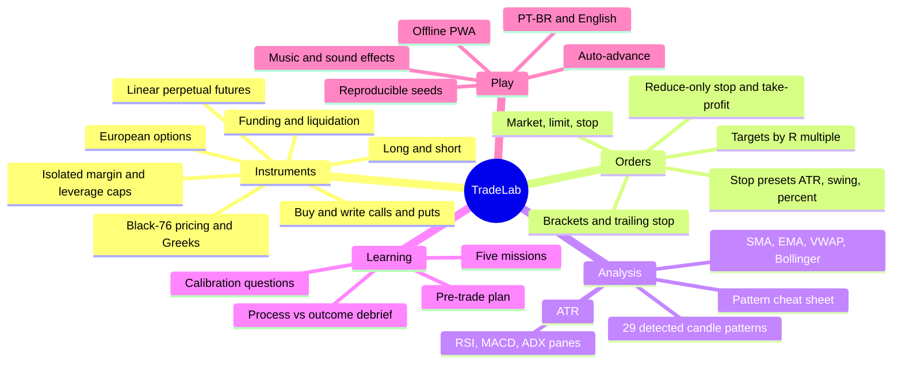
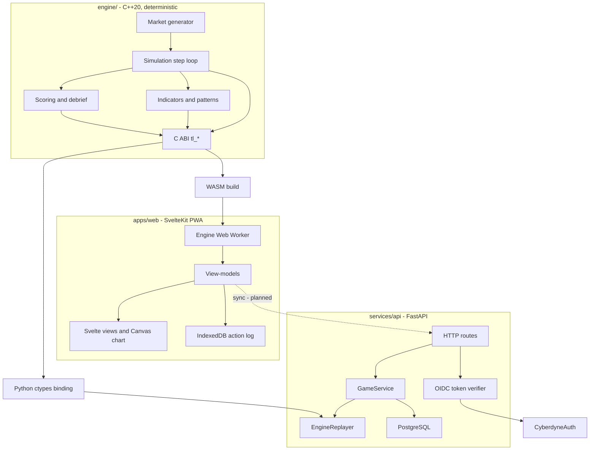
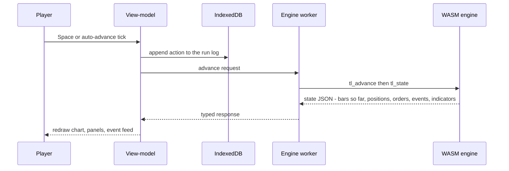
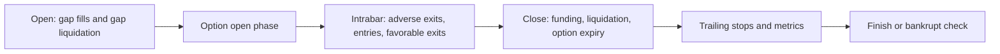
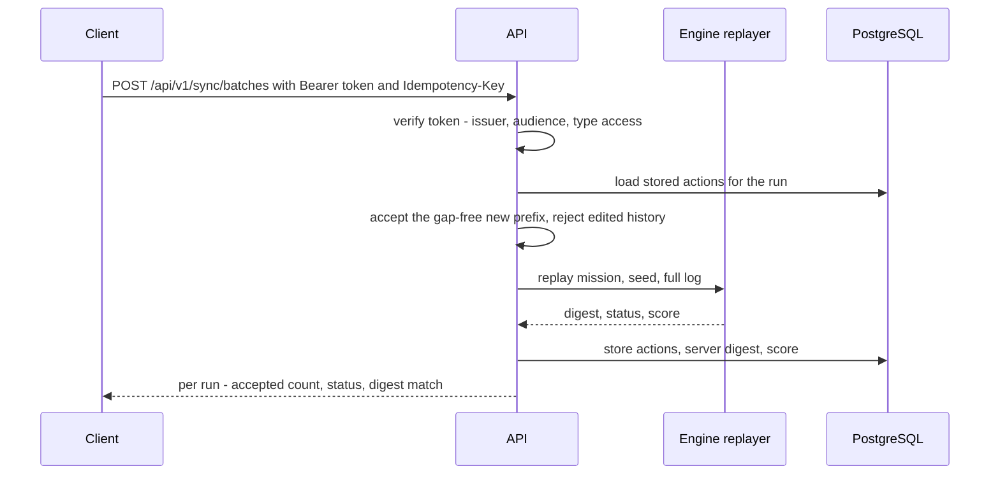
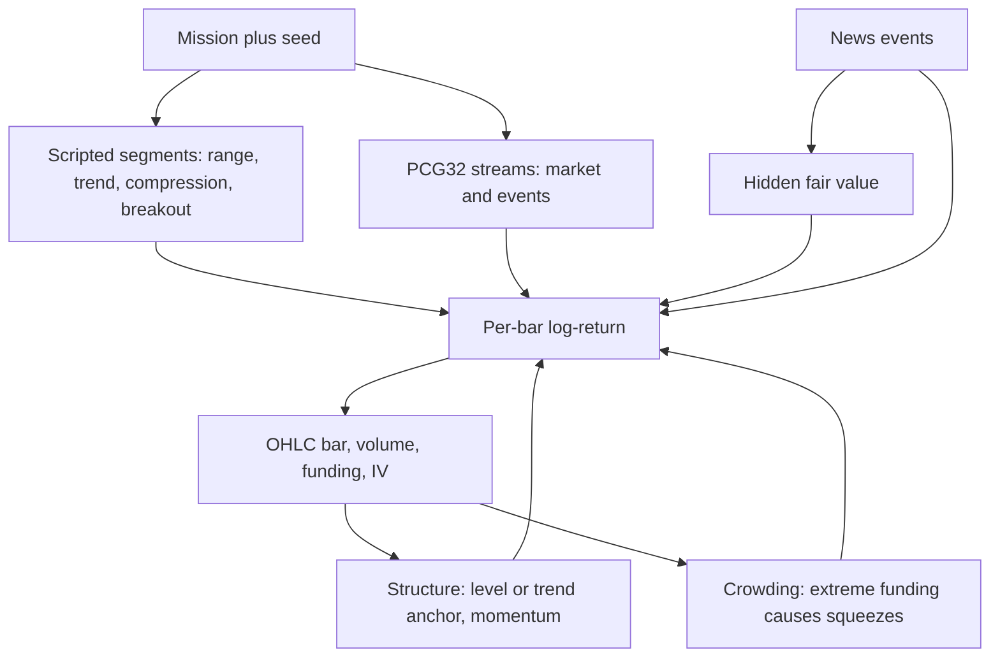
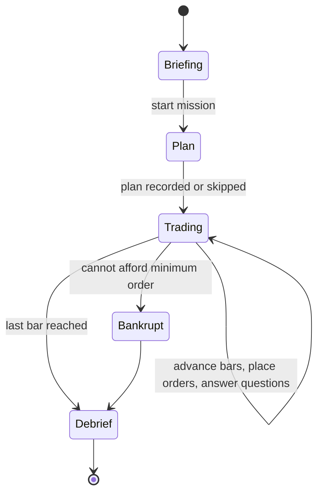

# Cyberdyne TradeLab

Educational trading game: learn **perpetual futures** (long/short, leverage, funding, liquidation) and **European options** (buy and write calls/puts) in a retro terminal, on synthetic markets that follow readable rules but never guarantee an outcome. Virtual money only — no real orders, ever.

| Where | What |
|---|---|
| `docs/product-spec.md` | Product vision and roadmap |
| `openspec/changes/` | Normative requirements (OpenSpec), one change per area — see [Specs](#specs-openspec) |
| `engine/` | Deterministic C++20 simulation core — [`engine/README.md`](engine/README.md) |
| `bindings/python/` | Python (ctypes) binding over the engine C ABI, used by the API |
| `apps/web/` | SvelteKit web client (PWA, works offline) — [`apps/web/README.md`](apps/web/README.md) |
| `services/api/` | FastAPI backend: sync, server-side replay, progress — [`services/api/README.md`](services/api/README.md) |
| `tools/` | Lint helpers (banned-API check for the engine) |

## Play locally

Requires Node 22+, CMake, Ninja and Emscripten (`brew install emscripten`).

```bash
cd apps/web
npm install
npm run engine:build   # compiles engine/ to WebAssembly
npm run dev            # http://localhost:5173
```

Add `?seed=123` to the URL to replay the same synthetic market.

| Key | Action |
|---|---|
| `Space` | Advance 1 bar (pauses auto-advance while it runs) |
| `Shift+Space` | Advance 5 bars |
| `A` | Auto-advance on/off (speeds 1×/2×/4×/10× in the top bar) |
| `M` | Sound on/off (music and effects; volumes in the menu settings) |
| `B` / `S` | Ticket side: buy / sell |
| `X` | Close position |
| `P` | Candle and chart pattern cheat sheet |
| `?` | Shortcut help |
| `Esc` | Close dialogs, cancel "mark on chart" |
| `Enter` | Submit the order (only when the submit button has focus — advancing never shares a key with submitting) |

Shortcuts are ignored while typing in a field, while a plan or calibration dialog is open, and while marking a level on the chart.

## Features



| Area | Details |
|---|---|
| Missions | 5 synthetic missions (table below). Each has a briefing, objectives, a leverage cap and a "what was really going on" reveal in the debrief. |
| Perpetual futures | Isolated margin, leverage up to the mission cap, funding every N bars, mark-to-market, liquidation, bankruptcy (game over when you can't afford the minimum order). |
| Options | Cash-settled European calls/puts priced with Black-76 on the perpetual, with an IV model, Greeks, option chain, writing with margin and margin calls. |
| Orders | Market / limit / stop entries, reduce-only stop-loss and take-profit (brackets, OCO), trailing stop, costs (fees, spread, slippage, bar-volume capacity). |
| Stop/target tools | Stop presets (1×/2× ATR, swing low/high, 1%/2%), targets at 1R/2R/3R, "mark on chart" picking, live reward/risk and an unprotected-position warning. |
| Indicators | SMA20, EMA50, VWAP (24-bar sessions) and Bollinger(20,2) overlays; RSI14, MACD(12,26,9) and ADX14/±DI panes; ATR14. All computed in the engine from closed bars only. |
| Candle patterns | 29 single- and multi-candle patterns detected in context (e.g. hammer vs hanging man), marked on the chart and linked to a cheat sheet that also covers 9 chart patterns. |
| Coaching | Pre-trade plan (side, invalidation, target, risk), calibration questions ("what's the probability that…?"), debrief that scores **process, not P&L**. |
| Auto-advance | Plays bars on a timer, waits for any open dialog, pauses on fills, liquidation, margin calls, option expiry and news. |
| Sound | Music follows the moment: menu theme, in-game theme, and a tense theme when you are near liquidation or under a margin call. Closing a trade plays a win or loss sting. `M` mutes; music and effects volumes are separate. Audio (`apps/web/static/audio`, MP3 96 kbps) is cached on first play, not at install. |
| Offline | Installable PWA; every action is committed to IndexedDB before it reaches the engine, so a reload resumes exactly where you were. |

### Missions

All synthetic, generated from the run seed, starting capital 10,000 (virtual).

| ID | Title | Instrument | Lesson | What the debrief reveals |
|---|---|---|---|---|
| `m01-false-breakout` | Range | Perpetual, up to 5× | Long and short, orders and stops | A false breakout: priced-in rumor, then a credible denial |
| `m02-funding-squeeze` | Momentum | Perpetual, up to 10×, funding every 4 bars | Funding and the cost of carry | Crowded longs, pullbacks to the EMA, then a squeeze |
| `m03-volatility-shock` | Quiet market | Perpetual, up to 20× | Margin, leverage and liquidation price | Volatility compression, then a gap shock |
| `m04-options-buyer` | Calls and puts | Options (buy) + perpetual up to 3× | Payoff, premium, IV and Greeks | IV run-up and crush around a rate decision; breakout direction not guaranteed |
| `m05-options-writer` | Selling premium | Options (buy and write) + perpetual up to 3× | Writing options, margin and margin calls | Rich premium in a range, then a jump forces a margin call |

## Architecture

One deterministic engine runs everywhere. Clients play offline; the server never trusts a client's balance or score — it replays the action log through the same engine and compares digests.



| Layer | Stack | Notes |
|---|---|---|
| Engine | C++20, CMake presets | Fixed-point int64 (`Price`, `Qty`, `Money` at 1e-8, `Rate` at 1e-10), own `det::` math kernels, PCG32 RNG, no I/O/clock/threads. Bit-identical on native x86-64/arm64, WASM and Python, locked by golden digests. |
| C ABI | `engine/include/tradelab/c_api.h` | `tl_run_create`, `tl_place_order`, `tl_advance`, `tl_state` (JSON), `tl_checkpoint`, `tl_debrief`, … — the only surface bindings use. |
| Web | SvelteKit + Svelte 5 runes, TypeScript strict, MVVM | Engine in a Web Worker; Canvas2D chart; i18n PT-BR first, English second; Vitest + Playwright. |
| API | Python 3.12, FastAPI, SQLAlchemy, hexagonal (ports/adapters) | Idempotent batch sync, replay through the engine, progress, export and erase. Access tokens from CyberdyneAuth verified via discovery + JWKS. |
| CI | GitHub Actions | `engine` (Linux/macOS native, WASM, lint, clang-tidy, OpenSpec validate), `web` (check, unit, e2e), `api` (pytest on SQLite and PostgreSQL). |

### How a bar is played

Everything the player does is a command in a log. The engine is the only thing that changes state, so replaying the log with the same mission and seed reproduces the run exactly.



Inside one step (`engine/src/advance.cpp`) the engine processes the next bar in a fixed order:



Intrabar order is **conservative**: when a bar touches both your stop and your target, the engine assumes the worse one happened first and flags the fill as ambiguous. The player only ever sees closed bars — indicators and patterns never look ahead (property-tested by mutating the future and comparing the past).

### Sync and server replay (backend)



The web client does not call the API yet (login via a BFF is the next milestone); the API itself is implemented and tested.

## How the market data is created

Markets are synthetic and generated by the engine from `(mission, seed)`. The goal is a market that **rewards good analysis on average without ever guaranteeing it**: technical structure, fundamental news and randomness all move the price, and calibration tests measure how much edge each one gives.



Each bar's log-return is the sum of:

| Component | Analysis it rewards | How it works |
|---|---|---|
| Segment drift and volatility | Reading the regime | Missions script segments (range, trend, quiet compression, breakout) with their own drift and vol; volatility clusters (GARCH-like) and has jumps. |
| Hidden fair value | Fundamental | A latent value moved by segment drift, by most of each information jump, and by news surprises. Price is pulled toward it slowly (`fair_pull`), so news has lasting effect. |
| News | Fundamental | Scheduled releases (headline, expected vs actual, credibility). A surprise moves fair value on the next bar and adds a short transient reaction. News before a breakout tilts its direction. |
| Level anchor | Technical (ranges) | In range segments price reverts to the range center and meets soft walls at the edges — fading extremes works more often than not. |
| Trend anchor and momentum | Technical (trends) | Trend segments revert to their 20-bar EMA (pullbacks get bought) and carry momentum. |
| Random-direction segments | Uncertainty | Breakouts pick a direction at random, tilted by the gap to fair value: the fundamental side wins more often, not always. |
| Crowding squeezes | Positioning | When funding is extreme, a sharp move against the crowded side becomes likely. Squeezes don't move fair value. |
| Noise | Randomness | Normal variates from a dedicated PRNG stream. |

**Calibration** (`engine/tests/test_generator.cpp`, 200 seeds per check) keeps the edges probabilistic. For example:

| Setup | Share that works (band asserted by the test) |
|---|---|
| Pure random walk (no structure) | ~50% (asserted 35–65%) |
| Fading RSI extremes inside a range | 58–72% |
| Buying a trend pullback | 57–72% |
| Shorting RSI > 70 in an uptrend | < 57% (a trap) |
| Breakout in the direction of good news | 60–85% |

### How reliable are signals in our data

The engine detects 29 candle patterns on closed bars. We measure how often a detected pattern "works" — the close 5 bars later moved in the pattern's direction — over 300 generated markets (5 missions × 60 seeds). These numbers are asserted by `engine/tests/test_candle_patterns.cpp`, so a generator change that makes them untrue fails CI.

| Signal | Samples | Next 5 bars go the predicted way | Test band |
|---|---|---|---|
| Any pattern on its own | 5,785 | 50.7% | 45–60% |
| Pattern plus an extreme RSI (< 30 bullish, > 70 bearish) | 599 | 55.9% | 45–62% |
| Kickers (gaps, usually caused by news) | 30 | 66.7% | > 60% |

What this means for the player:

- **Patterns alone are close to a coin flip**, which matches what research finds in real markets. The in-game cheat sheet says so plainly.
- **Context helps a little**: an exhausted RSI behind the pattern adds a few points.
- **Information helps most**: kickers are gaps driven by news, and news moves the hidden fair value, so they follow through more often. The kicker sample is small, so treat its rate as indicative.
- Nothing works every time — even the best setup above fails one time in three. That's why every lesson insists on a stop.

Volume, funding prints and implied volatility are derived from the same state. Historical packs (masked real markets from Market4Me) are specified but not built yet.

## How the game works



1. **Briefing** — the mission's story, objectives, instrument and leverage cap. A warm-up history is already on the chart.
2. **Plan** — before trading, write the hypothesis: side, invalidation (stop), target and risk. You can also explicitly plan to stay out — not trading is a valid decision.
3. **Trading** — advance bar by bar (or with auto-advance). Place orders, move stops, read news, watch funding. The game occasionally asks calibration questions ("probability price is higher in 10 bars?").
4. **Debrief** — the engine scores the run on process:

| Dimension | Weight | What it measures |
|---|---|---|
| Risk | 35 | Penalties for liquidation, entries without a stop, planned risk above 2% of capital, stops beyond the liquidation price, drawdown above 20% |
| Plan | 25 | Share of entries covered by a plan, and plans that name an invalidation level |
| Understanding | 25 | Reserved for lesson questions; not scored yet |
| Calibration | 15 | 100 × (1 − Brier score) of your probability answers (needs 3+ resolved answers) |

The total is the weighted average of the dimensions that apply to the run (no trades → no plan score). Net P&L is shown but is **not** the score: a disciplined losing trade can score well, a lucky reckless one scores badly. The debrief lists every trade — perpetual and options, with option trades settled at expiry — (R multiple, exit reason, plan respected; each trade's net includes its share of fees and the funding paid while it was open, so the trades add up to the result), findings, and a reveal of what the generator was doing.

## Specs (OpenSpec)

Requirements live in `openspec/changes/`, one change per area; `openspec list` shows task progress and `openspec validate --all --strict` runs in CI.

| Change | Capabilities |
|---|---|
| `add-deterministic-engine` | simulation-core, order-execution, perpetual-futures, options, indicators |
| `add-scenarios-and-gameplay` | market-generator, scenario-packs, gameplay-loop, mission-scoring, curriculum |
| `add-web-client` | web-client, terminal-ui |
| `add-cyberdyne-identity-and-backend` | player-identity, game-api, offline-sync |
| `add-native-clients` | desktop-client, ios-client |

## Status and roadmap

Built: the deterministic engine (perps, options, indicators, patterns, generator v2, scoring), the five missions, the web client (offline PWA) and the API (sync, replay, progress, export, erase).

Next:

- Web login through a BFF (needs TradeLab clients registered in CyberdyneAuth) and wiring the client to sync.
- `user_deleted` webhook, Alembic migrations, rate limits; deployment on Coolify.
- Historical packs from Market4Me, CSV import, curriculum map.
- Desktop client (C++20, Dear ImGui + SDL3), then iPad/iPhone (SwiftUI).

## Tests

```bash
# engine (native) and its WASM build
cd engine && cmake --preset native-debug && cmake --build --preset native-debug && ctest --preset native-debug

# web
cd apps/web && npm run check && npm test && npm run test:e2e

# api (needs the engine C ABI library: see services/api/README.md)
cd services/api && uv run --python 3.12 pytest -q

# specs
openspec validate --all --strict
```
